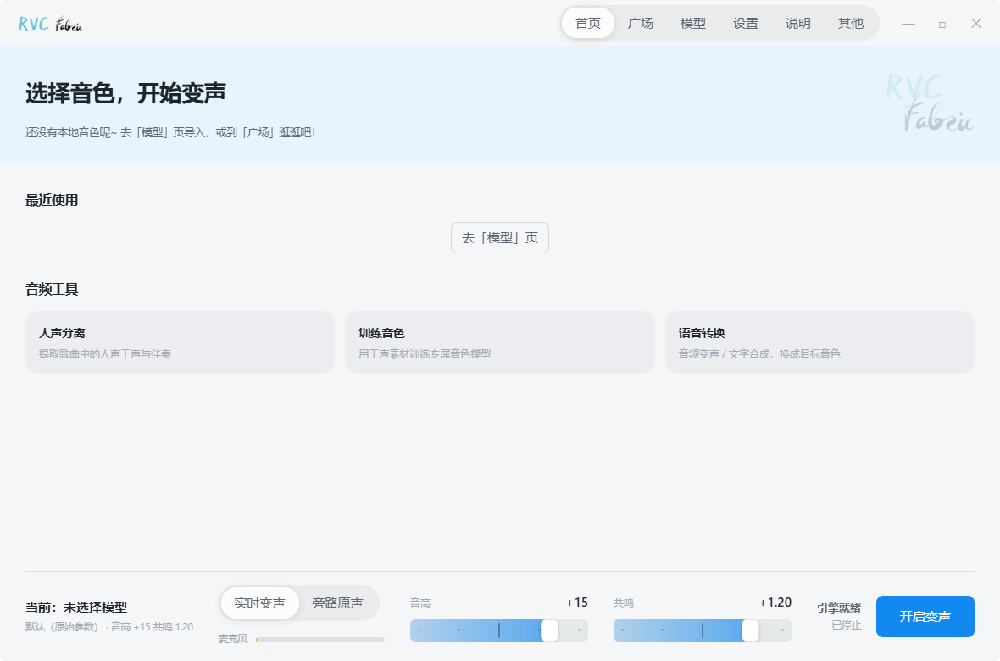
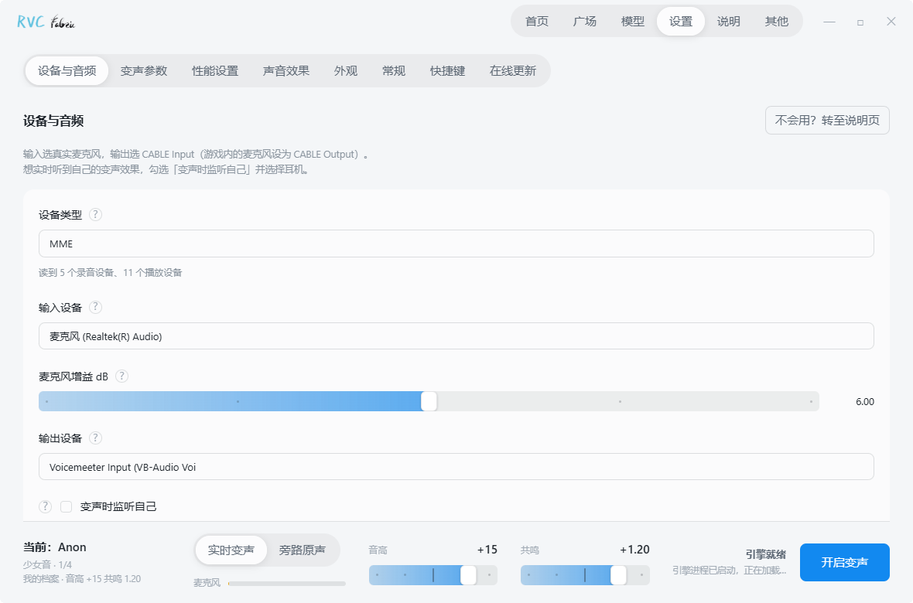
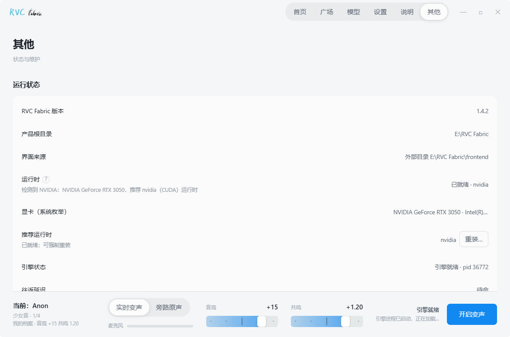

<div align="center">


# RVC Fabric

<!-- lang-nav -->
[简体中文](./README.md)　·　[繁體中文](./README_zh-TW.md)　·　[English](./README_en.md)　·　日本語　·　[한국어](./README_ko.md)　·　[Español](./README_es.md)　·　[Français](./README_fr.md)　·　[Русский](./README_ru.md)
<!-- lang-nav -->

**Windows 向けリアルタイム AI 音声変換とモデル学習**

<!-- screenshots -->



<!-- screenshots -->

以下は 2026 年 8 月にリポジトリに記録された過去の画面です。現在の画面とは異なる場合があります。

[公式サイト](https://www.turingmirror.com/ja/products/rvc-fabric/)

[利用ガイド](https://www.turingmirror.com/ja/guides/rvc-fabric/)

[Windows 版をダウンロード](https://cdn.turingmirror.com/d/rvc-fabric-setup)

[RVC WebUI](https://github.com/RVC-Project/Retrieval-based-Voice-Conversion-WebUI)をベースにディープカスタマイズ · [图灵镜 Turing Mirror](https://github.com/Turing-Mirror) が開発・メンテナンス

[](./LICENSE)
[](https://github.com/RVC-Project/Retrieval-based-Voice-Conversion-WebUI)

[GitHub リポジトリ](https://github.com/Turing-Mirror/RVC-Fabric) · [CNB成果物ダウンロード](https://cnb.cool/Turing-Mirror/RVC-Fabric-Releases)

**ソーシャルメディア**　[bilibili @图灵镜](https://space.bilibili.com/3546871148579062)　·　[抖音 @图灵镜](https://v.douyin.com/6NxXcrKK9cc)（抖音ID `TuringMirror`）　·　[小紅書 @图灵镜](https://www.xiaohongshu.com/user/profile/65f56bf1000000000b00e094)（小紅書ID `TuringMirror`）　·　[YouTube @图灵镜](https://www.youtube.com/@TuringMirror)（YouTube ハンドル `@TuringMirror`）　·　QQ グループ @图灵镜社区（グループ番号 `1077458748`）

<!-- qq-group -->

<!-- qq-group -->

**スポンサープロモーション**　[初月半額　·　高コスパクラウドサーバー / ゲームクラウド / パネルサーバー　·　雨云](https://www.rainyun.com/m1rror_?s=RVC-Fabric)

</div>

---

## プロジェクト概要

RVC Fabric は Turing Mirror が開発する無料のオープンソース Windows デスクトップアプリです。通話、配信、音声制作に向けて、リアルタイム音声変換、ボイス管理、ボーカル分離、モデル学習を提供します。初回利用時に実行環境を設定し、ボイスモデルをダウンロードまたはインポートしてください。

## 主な特徴

- マイク入力を選択したボイスに変換します。原音への切り替え、ASIO チャンネル選択、独立したモニタリングに対応しています。遅延はハードウェア、モデル、音声設定によって異なります。
- ノイズゲート、コンプレッサー、5 バンドパラメトリック EQ を内蔵しています。プリセットと個別の調整に対応しています。
- ボイスライブラリでは .index ファイルを関連付け、パラメータープリセットを保存、インポート、エクスポートできます。
- Turing Mirror とサードパーティの配布元からボイスモデルを取得できます。進捗の確認と中断したダウンロードの再開に対応しています。
- ボーカル分離、テキスト読み上げ、ボイス学習ツールを提供します。学習手順には音声分割、ピッチと特徴量の抽出、モデル学習、インデックスの書き出しが含まれます。
- NVIDIA CUDA と、AMD および Intel GPU の DirectML アクセラレーションに対応しています。セットアップでハードウェアを検出し、対応する実行環境を設定します。

2026 年 11 月 7 日時点で、Neptune ブランチにはスマートフォンのペアリング、ローカル API、MCP インターフェースがあります。スマートフォンで音声を収録し、デスクトップで変換します。ダウンロードしたビルドに含まれる機能は、そのバージョンのリリースノートで確認してください。

## クイックスタート

1. RVC_Fabric_Setup.exe を実行します。英数字のみのパスへのインストールを推奨します。
2. 案内に従って実行環境を設定し、ボイスモデルをダウンロードまたはインポートします。他のアプリへ音声を送る場合は VB-Cable をインストールします。インストール後はコンピューターを再起動します。
3. 本アプリの出力を CABLE Input に、QQ、Discord、配信アプリの入力を CABLE Output に設定します。

## 技術アーキテクチャと開発

### アーキテクチャ

RVC Fabricは **Tauri + Rust + React** のデスクトップシェルを採用し、バックグラウンドは **Python Worker** がすべての計算を担い、両者はJSONファイルプロトコルを通じて通信します：

```
RVC Fabric.exe (Tauri + Rust + React フロントエンドメインインターフェース)
    │
    ▼ JSON ファイルプロトコル (command.json / status.json / worker.pid)
Runtime\pythonw.exe tools/realtime_worker.py (Python 3.9 + CUDA / DirectML)
    └─> gui_v1.py (AudioIoProcess + rtrvc リアルタイム推論エンジン)
```

アップストリームの学習/推論WebUI（Gradio）は高度な機能としてパッケージに同梱されており、「その他」ページから開くことができます。

### 環境要件と開発

**環境要件**：Windows 10/11 · Node.js 20+ · Rust Stable · Python 3.13（開発スクリプト）

```bash
# 1. フロントエンドの依存関係をインストール
cd app
npm install

# 2. デスクトップ開発モードを起動 (WebView2 と MSVC ツールチェーンが必要)
npm run tauri:dev

# 3. UIブラウザプレビューのみを起動
npm run dev
```

### ビルドとテスト

- **単体テスト**：`scripts\run_tests.bat` を実行
- **フロントエンド単体テスト**：`cd app && npm test`
- **インストーラのパッケージ化（NSIS）**：`cd app && npm run tauri:build`
- **完全なオフラインパッケージの作成**：`python scripts\build_release.py --variant nvidia|amd|nvidia50`
- **オンラインカタログの構築**：`python scripts\build_catalog.py build --diff`

## オープンソースライセンスと免責事項

- 本プロジェクトのソースコードは [MIT License](./LICENSE) の下でオープンソース化されています。
- モデルの重み、音声パッケージ、サードパーティのリソースは、それぞれの元のライセンスに従います。
- **免責事項**：本ソフトウェアを身元詐称、詐欺、その他の違法な目的に使用しないでください。他者の声を学習・変換する前に、権利者の許可を取得してください。利用者は現地の法令を遵守する責任を負います。

## 謝辞

RVC Fabric に技術的サポートを提供してくださった以下の素晴らしいオープンソースプロジェクトに感謝します：

- [Retrieval-based-Voice-Conversion-WebUI](https://github.com/RVC-Project/Retrieval-based-Voice-Conversion-WebUI) — コアアルゴリズムとアップストリームの基礎
- [ContentVec](https://github.com/auspicious3000/contentvec) · [VITS](https://github.com/jaywalnut310/vits) · [HiFi-GAN](https://github.com/jik876/hifi-gan) · [RMVPE](https://github.com/Dream-High/RMVPE) — コア音響モデルとピッチアルゴリズム
- [faiss](https://github.com/facebookresearch/faiss) · [TorchGate](https://github.com/timsainb/TorchGate) — 検索とリアルタイムノイズリダクション
- [FCPE](https://github.com/CNChTu/FCPE) · [Parselmouth](https://github.com/YannickJadoul/Parselmouth) · [torchcrepe](https://github.com/maxrmorrison/torchcrepe) — オプションのピッチアルゴリズム
- [PyMSS](https://github.com/RVC-Project/Retrieval-based-Voice-Conversion-WebUI) — ボーカル分離エンジン（上流 RVC に追随し UVR5 を置き換え）· [Ultimate Vocal Remover](https://github.com/Anjok07/ultimatevocalremovergui) — 分離モデルの提供元 · [FFmpeg](https://github.com/FFmpeg/FFmpeg) — オーディオ処理
- [VB-Audio Virtual Cable](https://vb-audio.com/Cable/) — 仮想サウンドカード（ゲーム内でボイスチェンジした声を聞くために使用）
